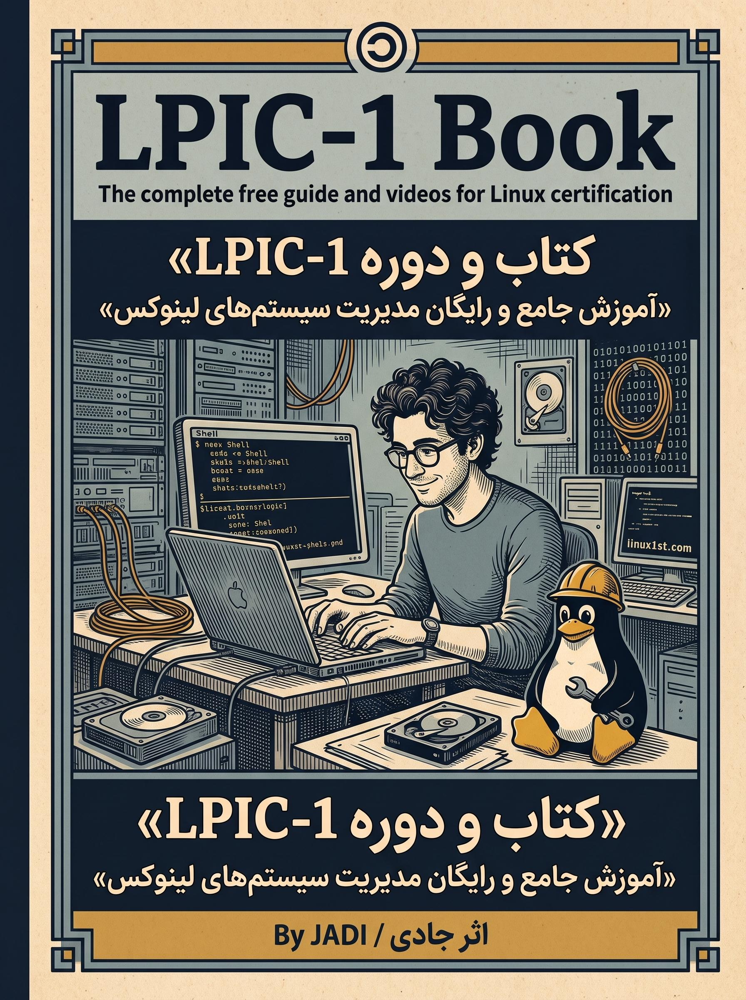

  

<h1 align="center">🐧 کتاب و درسنامه جامع LPIC-1 (نسخه فارسی)</h1>

  <strong>آموزش کامل سرفصل‌های آزمون بین‌المللی LPIC-1 نگارش ۵۰۰ (آزمون‌های ۱۰۱ و ۱۰۲) به همراه مثال‌ها و تمرین‌های عملی لینوکس</strong>

  

  

  

  

  

---

## 💡 چرا این پروژه؟

کتاب **LPIC-1** یکی از شناخته‌شده‌ترین منابع آزاد برای یادگیری مدیریت سیستم‌عامل گنو/لینوکس است. در این پروژه تمام **۴۶ درسنامه فارسی** متناظر با سرفصل‌های رسمی LPIC-1 v5.0 (Exam 101 &amp; 102) در پوشه `content_fa/` گردآوری و تکمیل شده است.

هدف این مخزن آموزشی اوپن‌سورس:
* 🎯 **پوشش کامل ۴۶ سرفصل آزمون ۱۰۱ و ۱۰۲** از معماری سخت‌افزار و بوت تا شبکه، اسکریپت‌نویسی و امنیت
* 💻 **ارائه هم‌زمان متن فارسی و منبع انگلیسی سرفصل‌ها** برای تسلط هم‌زمان بر مفاهیم عملی و واژگان استاندارد آزمون
* 🌍 **یادگیری رایگان و پروژه‌محور لینوکس** برای آمادگی آزمون رسمی LPI و ورود حرفه‌ای به دنیای مدیریت سرور

✍️ **نویسنده و مدرس اصلی:** جادی (Jadi) | 🌐 **نسخه مطالعه آنلاین و بازطراحی‌شده:** منتشرشده در پلتفرم آزاد [گیتاب (Gitab)](https://hheydarian.github.io/Gitab/books/book13/)

---

## ⚡ دسترسی سریع

| مرجع | توضیحات | لینک |
| :--- | :--- | :---: |
| 📖 **نسخه وب (گیتاب)** | مطالعه آنلاین تمام ۴۶ درسنامه با پوسته تاریک/روشن، فهرست دقیق و جستجوی سریع | [ورود به گیتاب ↗](https://hheydarian.github.io/Gitab/books/book13/) |
| 📥 **درسنامه‌های فارسی (Markdown)** | مشاهده و مطالعه مستقیم تمامی فایل‌های فارسی در مخزن | [مشاهده پوشه content_fa ↗](content_fa/) |
| 📚 **منبع انگلیسی سرفصل‌ها** | مشاهده سرفصل‌ها و جزوه‌های انگلیسی مرجع | [مشاهده پوشه content ↗](content/) |
| 🗺️ **ساختار و حمایت از پروژه** | بررسی نقشه محتوا و روش‌های مشارکت | [فهرست خام](content.md) · [صفحه حمایت](content/pages/support.md) |

---

## 🔍 راهنمای خوانایی بهتر در گیت‌هاب

برای اینکه متون فارسی در گیت‌هاب و مرورگر با خط استاندارد و چشم‌نواز نمایش داده شوند:
1. افزونه رایگان **[فونت ایران (FontIran)](https://chromewebstore.google.com/detail/fontiran/edbchgkbejkdkdkpgenlaciegoidmjoh)** را روی مرورگر نصب کنید.
2. فونت پیش‌فرض را روی **وزیرمتن (Vazirmatn)** یا **ایران‌یکان** قرار دهید تا خوانایی متن‌ها و دستورات به اوج برسد.

---

## 📚 فهرست سرفصل‌ها

تمامی **۴۶ سرفصل و درسنامه فارسی** در مسیر `content_fa/` به‌صورت کامل آماده مطالعه و تمرین است:

| شماره | عنوان سرفصل (انگلیسی) | عنوان فارسی | وضعیت | مطالعه مستقیم |
| :---: | :--- | :--- | :---: | :---: |
| **01** | Know your LPIC-1 version 5 exam | آشنایی با آزمون LPIC-1 نگارش ۵۰۰ | ✅ | [مطالعه فصل](content_fa/0001_know-your-lpic1-version-500.md) |
| **02** | Prepare your Lab | آماده‌سازی محیط آزمایشگاهی برای تمرین | ✅ | [مطالعه فصل](content_fa/0002_prepare-lpic101-102-lab.md) |
| **03** | 101.1 Determine and configure hardware settings | ۱۰۱.۱ شناسایی و پیکربندی تنظیمات سخت‌افزار | ✅ | [مطالعه فصل](content_fa/1011_determine_and_configure_hardware_settings.md) |
| **04** | 101.2 Boot the System | ۱۰۱.۲ بوت کردن سیستم لینوکس | ✅ | [مطالعه فصل](content_fa/1012_boot_the_system.md) |
| **05** | 101.3 Change runlevels / boot targets and shutdown or reboot the system | ۱۰۱.۳ تغییر سطوح اجرایی، اهداف بوت و خاموش‌کردن | ✅ | [مطالعه فصل](content_fa/1013_change_runlevels_and_shutdown_or_reboot_system.md) |
| **06** | 102.1 Design hard disk layout | ۱۰۲.۱ طراحی چیدمان دیسک سخت و پارتیشن‌ها | ✅ | [مطالعه فصل](content_fa/1021_design_hard_disk_layout.md) |
| **07** | 102.2 Install a boot manager | ۱۰۲.۲ نصب و پیکربندی لودر بوت (GRUB) | ✅ | [مطالعه فصل](content_fa/1022_install_a_boot_manager.md) |
| **08** | 102.3 Manage shared libraries | ۱۰۲.۳ مدیریت کتابخانه‌های اشتراکی | ✅ | [مطالعه فصل](content_fa/1023_manage_shared_libraries.md) |
| **09** | 102.4 Use Debian package management | ۱۰۲.۴ مدیریت بسته‌ها در دبیان و اوبونتو (APT و DPKG) | ✅ | [مطالعه فصل](content_fa/1024_use_debian_package_management.md) |
| **10** | 102.5 Use RPM and YUM package management | ۱۰۲.۵ مدیریت بسته‌ها در ردهت (RPM، YUM و DNF) | ✅ | [مطالعه فصل](content_fa/1025_use_rpm_and_yum_package_management.md) |
| **11** | 102.6 Linux as a virtualization guest | ۱۰۲.۶ لینوکس به عنوان ماشین مجازی مهمان | ✅ | [مطالعه فصل](content_fa/1026_linux_as_virtualization_guest.md) |
| **12** | 103.1 Work on the command line | ۱۰۳.۱ کار در محیط خط فرمان و پوسته | ✅ | [مطالعه فصل](content_fa/1031_work_on_the_command_line.md) |
| **13** | 103.2 Process text streams using filters | ۱۰۳.۲ پردازش جریان‌های متنی با فیلترها | ✅ | [مطالعه فصل](content_fa/1032_process_text_streams_using_filters.md) |
| **14** | 103.3 Perform basic file management | ۱۰۳.۳ مدیریت مقدماتی فایل‌ها و شاخه‌ها | ✅ | [مطالعه فصل](content_fa/1033_perform_basic_file_management.md) |
| **15** | 103.4 Use streams, pipes, and redirects | ۱۰۳.۴ استفاده از خط لوله‌ها، ورودی و خروجی‌ها | ✅ | [مطالعه فصل](content_fa/1034_use_streams_pipes_and_redirects.md) |
| **16** | 103.5 Create, monitor, and kill processes | ۱۰۳.۵ ایجاد، پایش و متوقف‌سازی فرآیندها | ✅ | [مطالعه فصل](content_fa/1035_create-_monitor_and_kill_processes.md) |
| **17** | 103.6 Modify process execution priorities | ۱۰۳.۶ تنظیم اولویت اجرای فرآیندها | ✅ | [مطالعه فصل](content_fa/1036_modify_process_execution_priorities.md) |
| **18** | 103.7 Search text files using regular expressions | ۱۰۳.۷ جستجو با عبارت‌های باقاعده (Regex) | ✅ | [مطالعه فصل](content_fa/1037_search_text_files_using_regular_expressions.md) |
| **19** | 103.8 Basic file editing (vi) | ۱۰۳.۸ ویرایش سریع فایل‌ها با ویرایشگر Vi | ✅ | [مطالعه فصل](content_fa/1038_perform_basic_file_editing_operations_using_vi.md) |
| **20** | 104.1 Create partitions and filesystems | ۱۰۴.۱ ساخت پارتیشن‌ها و فایل‌سیستم‌ها | ✅ | [مطالعه فصل](content_fa/1041_create_partitions_and_filesystems.md) |
| **21** | 104.2 Maintain the integrity of filesystems | ۱۰۴.۲ نگهداری و بررسی یکپارچگی فایل‌سیستم‌ها | ✅ | [مطالعه فصل](content_fa/1042_maintain_the_integrity_of_filesystems.md) |
| **22** | 104.3 Control mounting and unmounting of filesystems | ۱۰۴.۳ کنترل مانت و جداسازی دیسک‌ها (Mount) | ✅ | [مطالعه فصل](content_fa/1043_control_mounting_and_unmounting_of_filesystems.md) |
| **23** | 104.4 Manage disk quotas (Legacy) | ۱۰۴.۴ سهمیه‌بندی دیسک (Quotas - سرفصل قدیمی) | ✅ | [مطالعه فصل](content_fa/1044_manage_disk_quotas.md) |
| **24** | 104.5 Manage file permissions and ownership | ۱۰۴.۵ مدیریت سطوح دسترسی و مالکیت فایل‌ها | ✅ | [مطالعه فصل](content_fa/1045_manage_file_permissions_and_ownership.md) |
| **25** | 104.6 Create and change hard and symbolic links | ۱۰۴.۶ ساخت پیوندهای سخت و نمادین (Links) | ✅ | [مطالعه فصل](content_fa/1046_create_and_change_hard_and_symbolic_links.md) |
| **26** | 104.7 Find system files and place files in the correct location | ۱۰۴.۷ مکان‌یابی فایل‌ها و استاندارد FHS | ✅ | [مطالعه فصل](content_fa/1047_find_system_files_and_place_files_in_the_correct_location.md) |
| **27** | 105.1 Customize and use the shell environment | ۱۰۵.۱ سفارشی‌سازی محیط شل و پروفایل‌ها | ✅ | [مطالعه فصل](content_fa/1051_customize_and_use_the_shell_environment.md) |
| **28** | 105.2 Customize or write simple scripts | ۱۰۵.۲ نوشتن اسکریپت‌های کاربردی شل (Bash) | ✅ | [مطالعه فصل](content_fa/1052_customize_or_write_simple_scripts.md) |
| **29** | 105.3 SQL data management (Legacy) | ۱۰۵.۳ مدیریت مقدماتی پایگاه داده SQL (سرفصل قدیمی) | ✅ | [مطالعه فصل](content_fa/1053_sql_data_management.md) |
| **30** | 106.1 Install and configure X11 | ۱۰۶.۱ نصب و پیکربندی سیستم پنجره‌ای X11 | ✅ | [مطالعه فصل](content_fa/1061_install_and_configure_x11.md) |
| **31** | 106.2 Graphical Desktops | ۱۰۶.۲ مدیرهای دسکتاپ و نمایش (Display Managers) | ✅ | [مطالعه فصل](content_fa/1062_graphical_desktops.md) |
| **32** | 106.3 Accessibility | ۱۰۶.۳ دسترسی‌پذیری و امکانات معلولین (a11y) | ✅ | [مطالعه فصل](content_fa/1063_accessibility.md) |
| **33** | 107.1 Manage user and group accounts and related system files | ۱۰۷.۱ مدیریت حساب‌های کاربری، گروه‌ها و فایل‌های مربوطه | ✅ | [مطالعه فصل](content_fa/1071_manage_user_and_group_accounts_and_related_system_files.md) |
| **34** | 107.2 Automate system administration tasks by scheduling jobs | ۱۰۷.۲ خودکارسازی وظایف با زمان‌بندی (cron و at) | ✅ | [مطالعه فصل](content_fa/1072_automate_system_administration_tasks_by_scheduling_jobs.md) |
| **35** | 107.3 Localisation and internationalisation | ۱۰۷.۳ بومی‌سازی و تنظیمات زبان و منطقه (Locale) | ✅ | [مطالعه فصل](content_fa/1073_localisation_and_internationalisation.md) |
| **36** | 108.1 Maintain system time | ۱۰۸.۱ تنظیم و هماهنگ‌سازی زمان سیستم | ✅ | [مطالعه فصل](content_fa/1081_maintain_system_time.md) |
| **37** | 108.2 System logging | ۱۰۸.۲ ثبت و مدیریت لاگ‌های سیستم | ✅ | [مطالعه فصل](content_fa/1082_system_logging.md) |
| **38** | 108.3 Mail Transfer Agent (MTA) basics | ۱۰۸.۳ مبانی عامل انتقال ایمیل (MTA) | ✅ | [مطالعه فصل](content_fa/1083_mail_transfer_agent_mta_basics.md) |
| **39** | 108.4 Manage printers and printing | ۱۰۸.۴ مدیریت چاپگرها و صف چاپ (CUPS) | ✅ | [مطالعه فصل](content_fa/1084_manage_printers_and_printing.md) |
| **40** | 109.1 Fundamentals of internet protocols | ۱۰۹.۱ مبانی پروتکل‌های اینترنت و شبکه | ✅ | [مطالعه فصل](content_fa/1091_fundamentals_of_internet_protocols.md) |
| **41** | 109.2 Persistent network configuration | ۱۰۹.۲ پیکربندی پایدار و تنظیمات کارت شبکه | ✅ | [مطالعه فصل](content_fa/1092_basic_network_configuration.md) |
| **42** | 109.3 Basic network troubleshooting | ۱۰۹.۳ خطایابی و عیب‌یابی ارتباطات شبکه | ✅ | [مطالعه فصل](content_fa/1093_basic_network_troubleshooting.md) |
| **43** | 109.4 Configure client side DNS | ۱۰۹.۴ پیکربندی DNS در سمت کلاینت | ✅ | [مطالعه فصل](content_fa/1094_configure_client_side_dns.md) |
| **44** | 110.1 Perform security administration tasks | ۱۱۰.۱ مدیریت امنیت و دسترسی‌های ریشه‌ای | ✅ | [مطالعه فصل](content_fa/1101_perform_security_administration_tasks.md) |
| **45** | 110.2 Setup host security | ۱۱۰.۲ برقراری امنیت هاست و سرویس‌های باز | ✅ | [مطالعه فصل](content_fa/1102_setup_host_security.md) |
| **46** | 110.3 Securing data with encryption | ۱۱۰.۳ امن‌سازی و حفاظت از داده‌ها با رمزنگاری | ✅ | [مطالعه فصل](content_fa/1103_securing_data_with_encryption.md) |

---

## 🤝 مشارکت در پروژه (Contributions Welcome)

این کتاب یک اثر آزاد و جامعه‌محور است. هر تصحیح نگارشی، به‌روزرسانی فنی، تکمیل بخش‌های پیش‌نویس یا افزودن مثال‌های کاربردی، ارزش این منبع فارسی را برای همه علاقه‌مندان دوچندان می‌کند:

1. **فورک کنید (Fork):** ریپازیتوری را فورک کرده و یک برنچ جدید بسازید (`git checkout -b improve-lesson`).
2. **اصلاح و بازبینی:** متن یا فصل مورد نظر را در مسیر اصلی فصل‌ها ویرایش کنید.
3. **کامیت و ارسال:** تغییرات را ثبت کرده و یک Pull Request تمیز ارسال فرمایید.

> اگر سوال، ابهام یا پیشنهادی درباره مطالب کتاب دارید، خوشحال می‌شویم آن را از طریق بخش **[Issues](https://github.com/jadijadi/lpic1book/issues)** مطرح کنید.

---

## ⚖️ مجوز و حقوق مالکیت معنوی

این درسنامه با روحیه **دانش آزاد و جامعه لینوکس** به‌صورت رایگان منتشر شده است. استفاده، اشتراک‌گذاری آموزشی و ارسال اصلاحات برای ارتقای کیفیت درسنامه‌ها برای همگان آزاد است.

---

  ⭐ <strong>اگر این درسنامه در مسیر یادگیری لینوکس برایتان مفید بود، با دادن یک ستاره (Star) به مخزن اصلی از آموزش آزاد حمایت کنید!</strong> ⭐

  تقدیم به تمام علاقه‌مندان به دنیای لینوکس، سیستم‌عامل آزاد و مدیریت سرور 🐧

